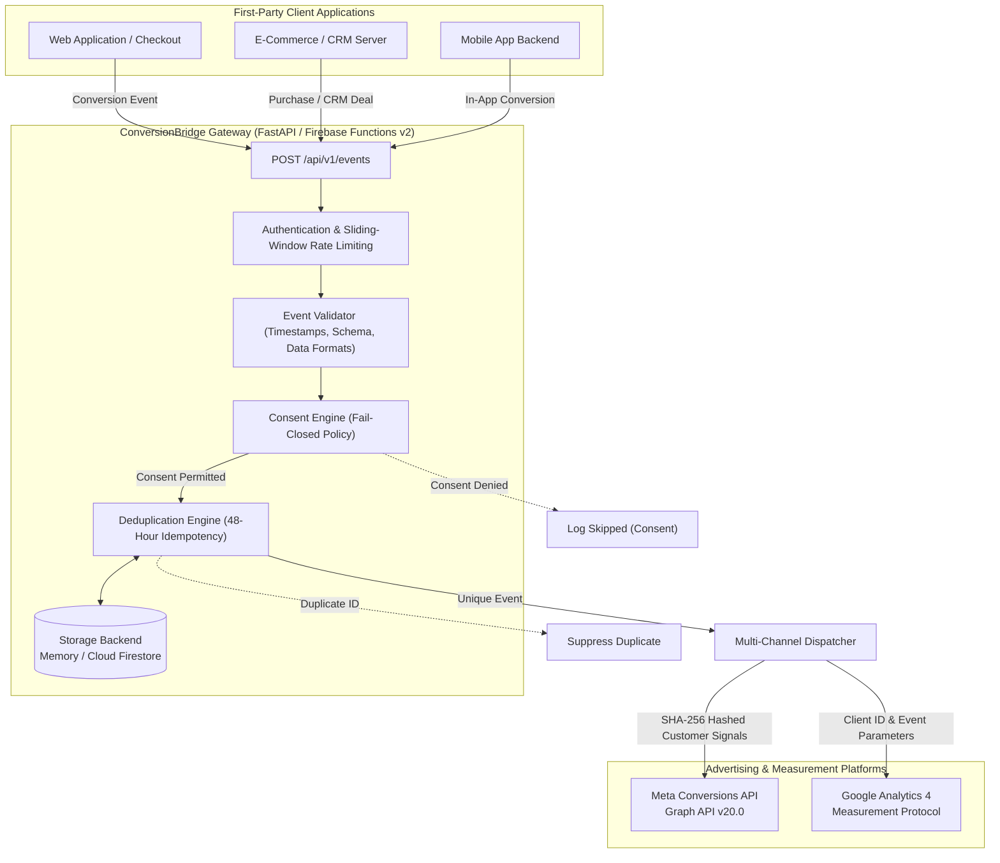

# ConversionBridge

<p align="center">
  <b>Privacy-First Server-Side Conversion Tracking for Meta Ads & Google Analytics 4.</b>
</p>

<p align="center">
  <a href="https://github.com/hamid-digitalmarketer/conversionbridge/actions"></a>
  
  
  
  <a href="LICENSE"></a>
  <a href="https://wa.me/923167417135"></a>
</p>

---

## 📌 Executive Summary

**ConversionBridge** is an enterprise-grade, open-source Python and Firebase solution for capturing consent-aware first-party conversion events and dispatching them directly to **Meta Conversions API (CAPI)** and **Google Analytics 4 (GA4) Measurement Protocol** via server-to-server integrations.

Modern performance marketing suffers from severe signal degradation caused by iOS App Tracking Transparency (ATT), browser ad-blockers, ITP cookie lifespan caps, and third-party cookie restrictions. Browser-only tracking routinely misses **15% to 30% of conversions**, distorting return on ad spend (ROAS) and crippling algorithmic bidding.

ConversionBridge restores measurement integrity by moving conversion delivery to a trusted, secure first-party server environment—enforcing user consent, eliminating duplicate transactions, and protecting customer privacy.

---

## 🏗️ System Architecture



---

## ✨ Key Capabilities

- **Unified Multi-Channel Gateway**: Ingests a single standardized first-party event and dispatches to Meta CAPI, GA4, or both in parallel.
- **Fail-Closed Consent Architecture**: Gated by explicit consent flags (`consent.advertising` for Meta, `consent.analytics` for GA4). If consent is missing or rejected, events are safely suppressed.
- **Cryptographic PII Protection**: Automatically normalizes and generates one-way SHA-256 hashes for customer emails, phone numbers, and physical addresses per platform specifications. Unhashed technical context (`_fbp`, `_fbc`, IP, User-Agent) is preserved.
- **Cross-Channel Deduplication**: Supports a 48-hour deduplication window using isolated storage keys (`meta:Lead:1001` vs `ga4:Lead:1001`) to prevent duplicate retries while preserving independent delivery.
- **Dual Runtime Support**: Operates as a native ASGI application (FastAPI / Uvicorn) for Docker/Cloud Run and as an HTTP Cloud Function on **Firebase Cloud Functions for Python (v2)**.
- **Dry-Run Test Endpoint**: Dedicated `POST /api/v1/events/test` route validates schemas, simulates consent rules, and generates safe wire-format previews without transmitting live advertising data.
- **Built-in Security Defenses**: API key/Bearer token protection, sliding-window rate limiting (120 req/min), body size limits (512 KB), and automated secret redaction in logs.

---

## 🛠️ Technology Stack

| Layer | Technologies |
|---|---|
| **Backend Framework** | Python 3.11 / 3.12, FastAPI, Pydantic v2, Pydantic-Settings |
| **Serverless Runtime** | Firebase Cloud Functions for Python (v2), Google Cloud Functions |
| **HTTP Client** | HTTPX (Asynchronous, connection pooling, timeout controls) |
| **Persistence & State** | Google Cloud Firestore (Distributed Serverless), In-Memory (Dev/Test) |
| **Quality & Testing** | Pytest, Pytest-Asyncio, Ruff (Linter & Formatter), MyPy |
| **CI / DevOps** | GitHub Actions CI, Firebase CLI, Google Secret Manager |

---

## 📦 Directory Structure

```
conversionbridge/
├── app/
│   ├── __init__.py
│   ├── main.py                  # FastAPI app & Firebase Functions v2 handler
│   ├── config.py                # Pydantic Settings configuration
│   ├── routes/
│   │   ├── events.py            # POST /api/v1/events & POST /api/v1/events/test
│   │   ├── health.py            # GET /health
│   │   └── status.py            # GET /api/v1/destinations/status
│   ├── schemas/
│   │   └── events.py            # Pydantic data models & validators
│   ├── services/
│   │   ├── event_processor.py   # Multi-destination dispatcher coordinator
│   │   ├── consent.py           # Privacy & consent evaluation engine
│   │   ├── deduplication.py     # Cross-channel deduplication service
│   │   └── validation.py        # Deep schema & integrity validator
│   ├── destinations/
│   │   ├── base.py              # BaseDestination abstract interface
│   │   ├── meta.py              # Meta Conversions API adapter
│   │   └── ga4.py               # GA4 Measurement Protocol adapter
│   ├── security/
│   │   ├── authentication.py    # API Key & Bearer token verification
│   │   ├── rate_limit.py        # Sliding-window rate limiter
│   │   └── secrets.py           # Secret masking & SHA-256 hashing
│   └── storage/
│       ├── base.py              # StorageBackend abstract interface
│       ├── memory.py            # Thread-safe in-memory cache
│       └── firestore.py         # Google Cloud Firestore transactional storage
├── tests/
│   ├── test_events.py           # API routes & validation tests
│   ├── test_consent.py          # Consent engine & privacy tests
│   ├── test_deduplication.py    # Deduplication & TTL window tests
│   ├── test_meta.py             # Meta CAPI adapter tests
│   ├── test_ga4.py              # GA4 adapter & debug mode tests
│   └── test_security.py         # Auth, rate limiting & secret redaction
├── examples/
│   ├── python_client.py         # Python backend integration script
│   ├── javascript_client.js     # Browser / Node.js integration script
│   ├── sample_event.json        # Standard sample payload
│   ├── sample_lead_event.json   # B2B lead generation payload
│   └── sample_purchase_event.json # E-commerce transaction payload
├── docs/
│   ├── architecture.md          # Detailed subsystem architecture
│   ├── meta-setup.md            # Meta Business Manager & token setup
│   ├── ga4-setup.md             # GA4 Data Stream & API secret setup
│   ├── deployment.md            # Firebase & Cloud Run deployment guide
│   ├── privacy-security.md      # GDPR/CCPA compliance & security posture
│   ├── troubleshooting.md       # Diagnostic guide & common error fixes
│   └── integration-guide.md     # Webhook & CMS implementation patterns
├── .github/workflows/ci.yml     # Automated CI linting & test pipeline
├── firebase.json                # Firebase Cloud Functions configuration
├── firestore.rules              # Firestore backend security rules
├── firestore.indexes.json       # Compound index & TTL definitions
├── .env.example                 # Environment configuration template
├── pytest.ini                   # Pytest async runner configuration
├── ruff.toml                    # Ruff linter rules
├── LICENSE                      # MIT License
└── README.md
```

---

## 🚀 Quick Start Guide

### 1. Clone & Set Up Virtual Environment

```bash
git clone https://github.com/hamid-digitalmarketer/conversionbridge.git
cd conversionbridge

python -m venv venv
# Windows:
venv\Scripts\activate
# macOS/Linux:
source venv/bin/activate

pip install -r requirements-dev.txt
```

### 2. Configure Local Environment

Copy the example environment file and add your credentials:
```bash
cp .env.example .env
```

Key environment settings:
```ini
ENVIRONMENT=development
REQUIRE_API_KEY=false
STORAGE_BACKEND=memory

# Meta Conversions API
META_ENABLED=true
META_PIXEL_ID=123456789012345
META_ACCESS_TOKEN=EAAG_your_token_here

# GA4 Measurement Protocol
GA4_ENABLED=true
GA4_MEASUREMENT_ID=G-XXXXXXXXXX
GA4_API_SECRET=your_api_secret_here
```

### 3. Run Automated Tests & Linting

```bash
# Run 38 unit & integration tests
pytest -v

# Run code style and linter checks
ruff check .
```

### 4. Start Local Development Server

```bash
python -m uvicorn app.main:app --port 8080 --reload
```
Interactive OpenAPI documentation will be accessible at `http://localhost:8080/docs`.

---

## 📡 API Usage & Example Payloads

### Ingest a Conversion Event (`POST /api/v1/events`)

```bash
curl -X POST http://localhost:8080/api/v1/events \
  -H "Content-Type: application/json" \
  -d '{
    "event_name": "Lead",
    "event_id": "lead_20261019_001",
    "event_time": 1729304859,
    "event_source_url": "https://example.com/consultation",
    "action_source": "website",
    "consent": {
      "analytics": true,
      "advertising": true
    },
    "user_data": {
      "email": "customer@example.com",
      "phone": "+15551234567",
      "first_name": "Sarah",
      "last_name": "Connor",
      "country": "us",
      "client_id": "123456789.1729304859",
      "fbp": "fb.1.1729304859.1029384756"
    },
    "custom_data": {
      "value": 150.00,
      "currency": "USD",
      "content_name": "Growth Strategy Audit"
    },
    "destinations": ["meta", "ga4"],
    "test_mode": false
  }'
```

#### Successful JSON Response:
```json
{
  "success": true,
  "event_id": "lead_20261019_001",
  "event_name": "Lead",
  "results": [
    {
      "destination": "meta",
      "status": "sent",
      "status_code": 200,
      "message": "Meta accepted event successfully (events_received: 1)",
      "event_id": "lead_20261019_001",
      "payload_preview": null
    },
    {
      "destination": "ga4",
      "status": "sent",
      "status_code": 204,
      "message": "GA4 accepted event via Measurement Protocol (HTTP 204/200)",
      "event_id": "lead_20261019_001",
      "payload_preview": null
    }
  ],
  "timestamp": 1729304860
}
```

---

## 🔒 Security & Privacy Guarantees

1. **One-Way SHA-256 Hashing**: Direct customer identifiers (`email`, `phone`, `names`) are never sent in plaintext over external networks.
2. **Fail-Closed Privacy**: Omitting consent causes ConversionBridge to block outbound requests before network transmission.
3. **SSRF Prevention**: All external HTTP requests route exclusively to predefined platform endpoints (`graph.facebook.com` and `google-analytics.com`). Arbitrary URLs are strictly rejected.
4. **Zero Persistent PII**: Deduplication records store only hashed routing keys and timestamps. Customer details are not permanently retained in the database.

---

## ⚠️ Important Technical Limitations

- **Attribution vs. Event Acceptance**: Receiving an HTTP 200/204 response from Meta or Google confirms successful receipt of the data. It **does not guarantee** that Meta or Google will attribute that conversion to an advertising campaign. Attribution depends on platform match keys, auction models, and user conversion windows.
- **Privacy Policy Compliance**: Server-side tracking does not eliminate the legal obligation to obtain user consent under GDPR, CCPA/CPRA, and relevant data privacy legislation.
- **GA4 Reporting Latency**: Events sent to GA4 Measurement Protocol appear in DebugView immediately, in Realtime reports within minutes, and in standard attribution reports within 24 to 48 hours.

---

## 🗺️ Product Roadmap

- [x] Dual Meta Conversions API & GA4 Measurement Protocol adapters.
- [x] Fail-closed privacy & consent management engine.
- [x] Cross-channel deduplication with Firestore & Memory storage.
- [x] Dual runtime (Uvicorn ASGI + Firebase Functions v2).
- [ ] TikTok Events API adapter.
- [ ] Google Ads Enhanced Conversions for Leads direct API integration.
- [ ] BigQuery raw event archiving pipeline.

---

## 🤝 Contributing & License

Contributions are welcome! Please review [CONTRIBUTING.md](CONTRIBUTING.md) and our [SECURITY.md](SECURITY.md) guidelines.

Released under the [MIT License](LICENSE). Copyright © 2026 Muhammad Hamid.

---

## Let's Build Better Conversion Tracking

Need reliable server-side conversion tracking for your business? I can help implement Meta Conversions API, Google Analytics 4 Measurement Protocol, lead tracking, purchase events, and custom conversion measurement workflows.

Whether you're running an e-commerce store, generating leads, managing paid advertising campaigns, or building a SaaS product, let's discuss a tracking setup tailored to your requirements.

Contact me directly on WhatsApp to discuss your project.

💬 **WhatsApp**: [+92 316 7417135](https://wa.me/923167417135)
