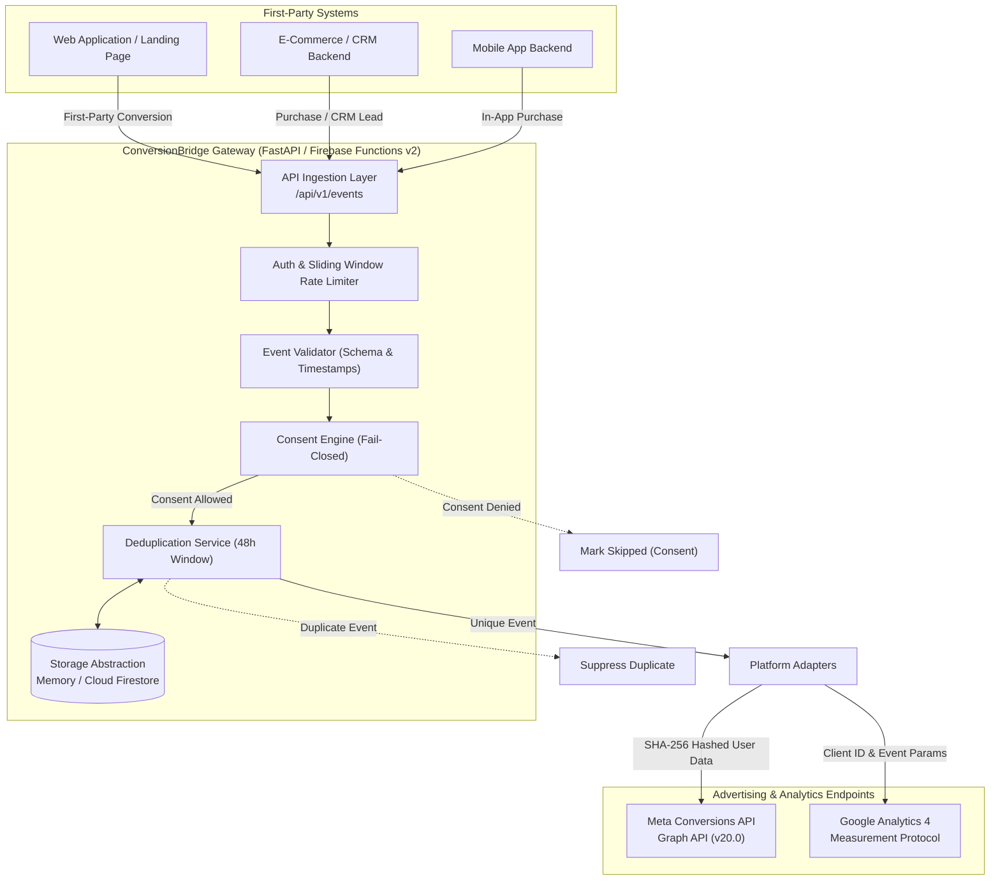

# ConversionBridge System Architecture

ConversionBridge is an open-source, privacy-first server-side conversion tracking gateway built with Python 3.11+, FastAPI, and Firebase Cloud Functions v2. It provides a secure, decoupled bridge between first-party business applications and third-party advertising and analytics platforms.

---

## High-Level Topology

---

## Core Subsystems

### 1. Ingestion & Security Perimeter
- **FastAPI / ASGI & Firebase Functions v2**: Dual execution model allows ConversionBridge to run as a native serverless HTTP function on Google Cloud Functions or inside containerized Docker/Cloud Run environments.
- **Authentication**: Optional Bearer token or `X-API-Key` verification prevents unauthorized third-party submissions.
- **Sliding-Window Rate Limiter**: Enforces configurable request quotas (default 120 req/min) per client key or origin IP.
- **Payload Size Clamping**: Restricts request entity sizes to 512 KB to safeguard against buffer exhaustion and DoS attacks.

### 2. Privacy & Consent Engine
- **Independent Consent Signals**: Tracks `analytics` and `advertising` consent separately.
- **Fail-Closed Policy**: If consent is missing, malformed, or explicitly denied, outbound dispatch to the respective platform is unconditionally blocked.
- **No Circumvention**: ConversionBridge never manufactures synthetic consent signals or bypasses user privacy preferences.

### 3. Event Deduplication Architecture
- **Stable Identifiers**: Utilizes `event_id` as the authoritative cross-channel transaction identifier.
- **Destination Isolation**: Deduplication keys are namespaced per platform (`meta:Lead:lead_123` vs `ga4:Lead:lead_123`). This guarantees that GA4 accepting an event does not inadvertently suppress Meta delivery.
- **Persistent State**:
  - `MemoryStorage`: Thread-safe in-memory cache for local development and unit tests.
  - `FirestoreStorage`: Atomic transactional writes in Google Cloud Firestore for multi-instance production environments with automated TTL expiration.

### 4. Destination Adapters
- **Meta Conversions API (`app/destinations/meta.py`)**:
  - Automatically normalizes and applies SHA-256 hashing to sensitive customer identifiers (email, phone, names, location).
  - Preserves unhashed technical context (`client_ip_address`, `client_user_agent`, `_fbp`, `_fbc`).
  - Supports `test_event_code` for verification inside Meta Events Manager.
- **GA4 Measurement Protocol (`app/destinations/ga4.py`)**:
  - Normalizes event names to GA4 standards (snake_case, max 40 chars).
  - Validates client identifiers and maps custom properties into event parameters.
  - Supports GA4 DebugView validation (`/debug/mp/collect`).
